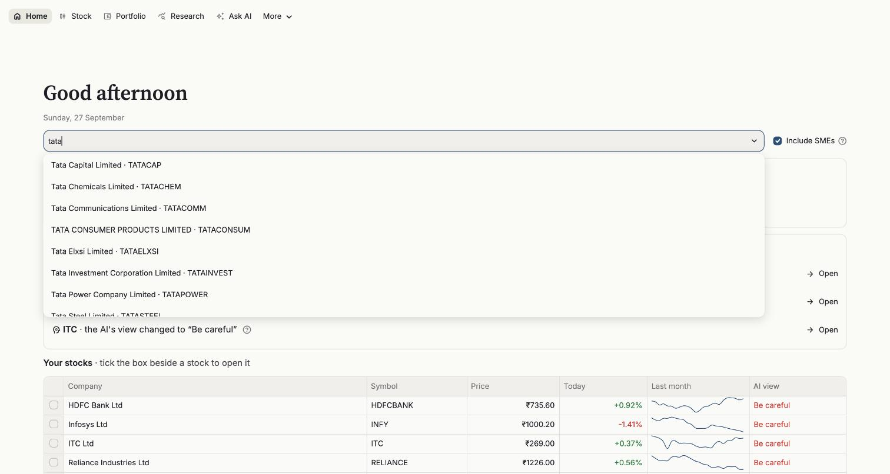
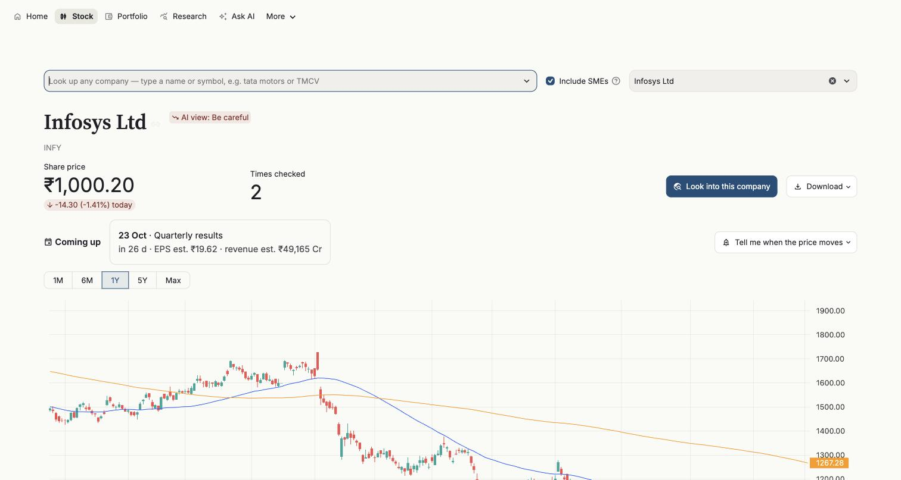
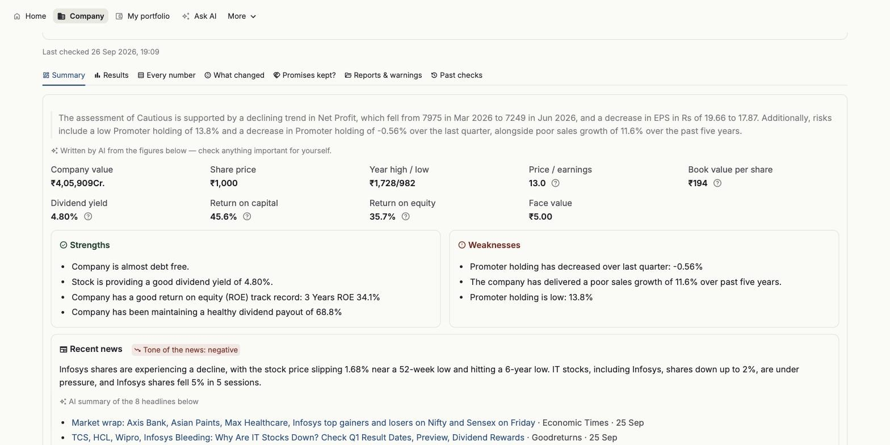
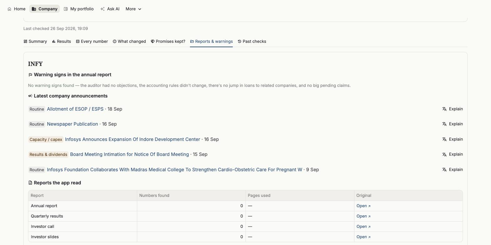
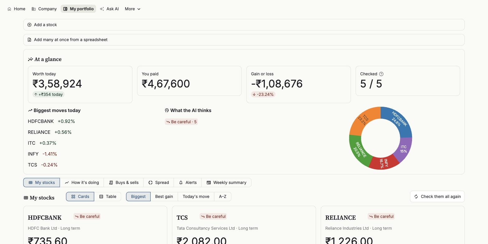
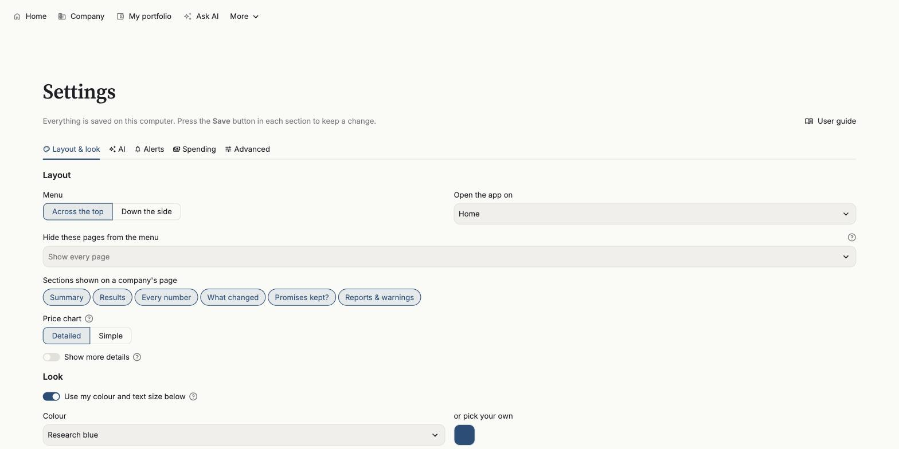
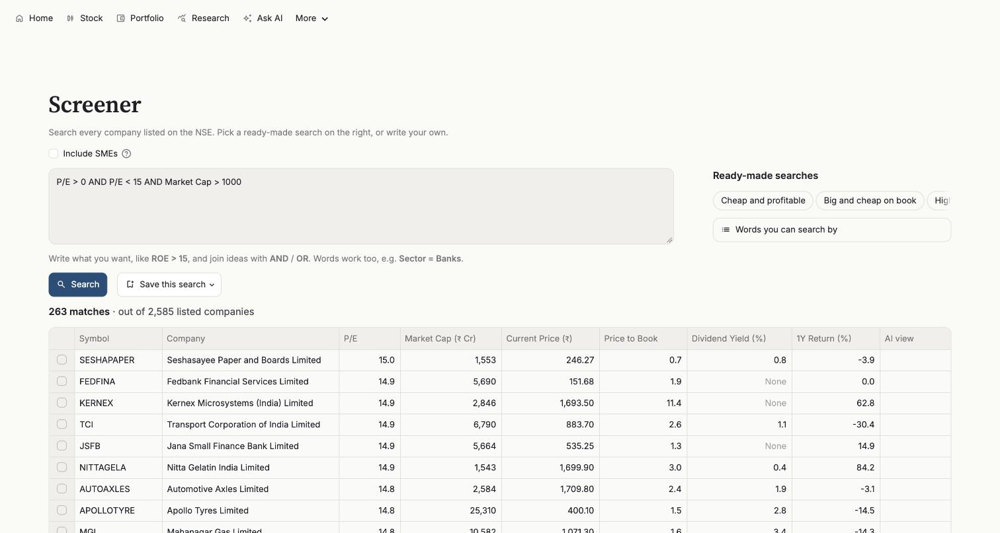
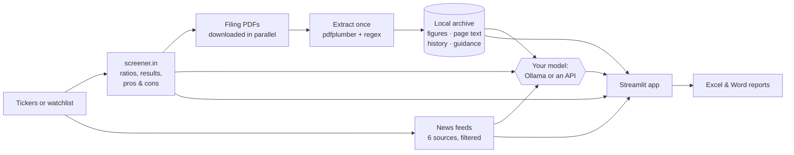

# Indian Stock Data Hub

**Look up any company listed in India and see, in plain English, how it's doing, what its bosses promised, and whether anything in its reports should worry you.** Free, open source, and private: it runs on your own computer, and what you own never leaves it.


<table>
  <tr>
    <td></td>
    <td></td>
  </tr>
  <tr>
    <td align="center"><sub>Home: a search list of every company, today's value, what needs your attention (demo portfolio)</sub></td>
    <td align="center"><sub>The Stock page: price, what's coming up, candlestick chart</sub></td>
  </tr>
  <tr>
    <td></td>
    <td></td>
  </tr>
  <tr>
    <td align="center"><sub>Summary: the AI's view, key numbers, strengths, weaknesses, news</sub></td>
    <td align="center"><sub>Reports & warnings: annual-report warning signs and announcements</sub></td>
  </tr>
  <tr>
    <td></td>
    <td></td>
  </tr>
  <tr>
    <td align="center"><sub>Portfolio (demo): value, gain or loss, biggest moves, the AI's view</sub></td>
    <td align="center"><sub>Settings: layout, chart style and <i>Show more details</i></sub></td>
  </tr>
  <tr>
    <td colspan="2"></td>
  </tr>
  <tr>
    <td colspan="2" align="center"><sub>Screener: every NSE-listed company, with SMEs a tick away</sub></td>
  </tr>
</table>

> **New here?** The short [**User guide (PDF)**](static/user_guide.pdf) explains every screen in plain English. It's also linked from the app's Home and Settings pages.

---

## Set it up the easy way

Paste this into an AI assistant that can work on your computer (Claude Code, Claude Desktop, ChatGPT's desktop app, Codex, Cursor…) and it will install everything for you. A chat-only assistant will walk you through it instead.

```text
Please set up the "Indian Stock Data Hub" app on my computer. I'm not
technical, so do every step yourself where you can, explain anything I
need to do in plain words, and check each step worked before moving on.

1. Check that Python 3.10 or newer is installed (python3 --version, or
   python --version on Windows). If not, install it from python.org. On
   Windows, tick "Add python.exe to PATH" in the installer.
2. Download the app into my Documents folder:
   git clone https://github.com/tapariapurv/indian-stock-data-hub.git
   (If git isn't available, download and unzip
   https://github.com/tapariapurv/indian-stock-data-hub/archive/refs/heads/main.zip)
3. In the app's folder, make a virtual environment and install the app:
   python3 -m venv .venv
   then  .venv/bin/python -m pip install -r requirements.txt
   (Windows: .venv\Scripts\python -m pip install -r requirements.txt)
4. Install Ollama, the free AI, from https://ollama.com/download and make
   sure it's running. Download a model that suits my computer's memory:
   "ollama pull gemma4:e2b" for 8 GB, "ollama pull gemma4:e4b" for 16 GB
   or more.
5. Start the app with  .venv/bin/python -m streamlit run app.py
   (Windows: .venv\Scripts\python -m streamlit run app.py)
   It opens at http://localhost:8501. In the app, go to Settings → AI,
   choose Ollama, press "Check it works", pick the model, and press
   "Save AI settings".
6. Ask me whether I'd like the app to start by itself when I log in. If
   yes, it's in Settings → Advanced → Speed & memory → Start automatically.
7. Finish by telling me, in two or three plain sentences, how to open the
   app next time.

Don't edit any of the app's files, and ask me before installing anything
that costs money (nothing here should).
```

## What you won't find elsewhere

Plenty of sites show you a company's numbers. These come from the app reading the company's own documents and keeping its own record:

- **Warning signs in the annual report.** The app searches the report for what analysts dig for: an auditor who wasn't fully satisfied, a change in accounting rules, a jump in loans to companies linked to the owners, and tax demands or claims the company hasn't accepted. It uses plain pattern matching, not AI, so it can't invent anything, and every warning shows its page.
- **Announcements, explained.** Companies file notices with the stock exchange constantly, often as long legal PDFs. Each one is tagged straight away (a resignation, a tax demand, a new order, routine paperwork…), and **Explain** turns it into three plain points and a yes/no on whether it could matter.
- **Were the promises kept?** Every quarter the bosses commit to something on the investor call: margins, growth, cutting debt. The app files those promises and checks them against the results reported later. Over a few quarters you learn something no stock screener shows: how often this management does what it says.
- **Ask in your own words.** **Ask AI** answers from your portfolio, your past analyses and every report the app has downloaded, and shows where each fact came from.
- **What changed since last time.** Every check is saved, so the app can list exactly what moved. It's a straight comparison with no AI, so nothing is made up.

## Features

- **Home:** one search box listing every NSE company (main board and SME) that you filter by typing a name or symbol, what your stocks are worth today, a short *Needs your attention* list, and all your stocks in one table.
- **A page for every company:** price and a candlestick chart with 50- and 200-day averages (or a simple line), upcoming results and dividends, whether the share is cheap or dear against its own history, and seven sections: Summary, Results, Every number, What changed, Promises kept?, Reports & warnings, and Past checks. It works for any listed company, not only ones you own.
- **Plain English everywhere:** the AI's view is *Looks good*, *Mixed picture* or *Be careful*; ratios are explained on hover; a **Show more details** switch brings back every figure, the original financial terms, AI costs, model names and file paths.
- **Your portfolio:** accounts, live value and gain or loss, how it has done against the market, how your money is spread, and every buy and sell with profit on shares sold (oldest sold first, as Indian tax rules count it) and a yearly return.
- **Alerts:** a Mac pop-up or an email when the AI's view changes, a company publishes something important, a promise isn't kept, or a price you're watching is reached, plus a weekly summary.
- **Every number from the reports:** thousands of figures read from the PDFs, each with its page and the sentence it came from.
- **Screener, Compare, Research:** ready-made or custom searches across every NSE-listed company (tick *Include SMEs* for SMEs), companies side by side, and a spreadsheet or Word report for a whole list at once.
- **Your choice of AI:** Ollama for free on your own computer (the default), or Anthropic, OpenAI, Google, OpenRouter or any OpenAI-compatible server, with spending limits that can't be exceeded.
- **Make it yours:** menu across the top or down the side, which page it opens on, hide the pages you don't use, choose a company page's sections, colour, text size and spacing.
- **Light enough to leave running:** reports are read in separate low-priority processes held to the CPU and memory limits you set, so the app stays quick while it works. It can start by itself when you log in, on macOS, Windows and Linux.

## Quick start (by hand)

You need **Python 3.10 or newer** ([download](https://www.python.org/downloads/); on Windows, tick *"Add python.exe to PATH"* in the installer).

```bash
# 1. Get the code
git clone https://github.com/tapariapurv/indian-stock-data-hub.git
cd indian-stock-data-hub

# 2. Create and activate a virtual environment
python3 -m venv .venv
source .venv/bin/activate          # Windows: .venv\Scripts\activate

# 3. Install dependencies
python -m pip install -r requirements.txt

# 4. Run
python -m streamlit run app.py
```

The app opens at **http://localhost:8501** on the Home page. Type a company's name in the search box to begin.

No git? Click **Code → Download ZIP** on GitHub, unzip it, and run steps 2 to 4 inside the folder.

## Choosing a model (optional)

Everything except the AI summaries, **Explain**, promise checking and **Ask AI** works without a model. There are four ways to set one up, and you can switch at any time in **Settings → AI**.

| Route | Good when | Cost | Your data |
|---|---|---|---|
| **Ollama** | The simplest local setup. The default. | Free | Stays on your machine |
| **A local app** | You already run LM Studio, Jan or llama.cpp | Free | Stays on your machine |
| **A hosted API** | You want the strongest models | Per token | Sent to that provider |
| **Your own server** | A GPU box, work server or rented instance | Yours | Stays on that server |

**Ollama.** Install from [ollama.com/download](https://ollama.com/download) (Linux: `curl -fsSL https://ollama.com/install.sh | sh`), check `http://localhost:11434` says *Ollama is running*, then `ollama pull <name>` with any chat model from the [library](https://ollama.com/library). Size is what matters: roughly 1–2 GB on 8 GB of RAM, 4–8 GB on 16 GB, larger above that. Small models are fast but misread financial context — one we tested called a 7.6% ROE a "strong position" — so treat their verdicts with caution.

**A local app or your own server.** Turn on its OpenAI-compatible endpoint, then pick *Custom / self-hosted* and paste the address (e.g. `http://localhost:1234/v1`). For Ollama on another machine, keep the Ollama provider and change the address.

**A hosted API.** Pick the provider, paste a key, press *Check it works*:

| Provider | Key from | Environment variable |
|---|---|---|
| Anthropic | console.anthropic.com | `ANTHROPIC_API_KEY` |
| OpenAI | platform.openai.com | `OPENAI_API_KEY` |
| Google (Gemini) | aistudio.google.com | `GOOGLE_API_KEY` |
| OpenRouter | openrouter.ai | `OPENROUTER_API_KEY` |
| Custom / self-hosted | your own server | `CUSTOM_API_KEY` |

An environment variable always wins over a key saved in `settings.json`, so you never have to write one to disk. `settings.json` is gitignored and written with owner-only permissions.

## Keeping a paid model on a leash

**Settings → Spending** enforces three limits, and a call that would cross one is refused *before it is sent*:

| Limit | Default | What it's for |
|---|---|---|
| Tokens per run | 50,000 | The one that saves you — a 50-company watchlist can spend a month's budget in one click |
| Monthly cost | 5.00 | A ceiling in your currency, counted from the 1st |
| Monthly tokens | off | The same idea for free tiers with an allowance |

Every call is written to a local ledger, so the spend shown is what actually happened, broken down by provider, model and what it was spent on. Enter your provider's price per million tokens (input and output) next to its key — the app ships no price list, because a stale one is worse than none. Local models are free, recorded as free, and never blocked.

For scale: a company review is ≈400 tokens, a news digest ≈300, an archive question ≈2,800 including the search steps. Answers are cached, so re-running a company costs nothing.

## Analysing a watchlist

**Research** takes a list of symbols, or a CSV or Excel file with a `ticker` column (`symbol`, `scrip`, `code` and `NSE code` also work; otherwise the first column is used). The page has a **Download an example** button that gives you the right shape:

```csv
ticker,notes
RELIANCE,core holding
TCS,
INFY,watching
```

## How it works



- **Scraping:** company pages from [screener.in](https://www.screener.in); filings from the links listed there (BSE, NSE and company sites); news from public RSS feeds. Requests are pooled and paced, filings download in parallel, and PDFs are cached in `downloads/`.
- **Extraction:** pure code, no AI. Every number in each PDF is captured with its page and surrounding text, then labelled and categorised by keyword rules. Results are keyed by file hash in the archive, so a filing is parsed **once, ever** — however many times you re-analyse it.
- **AI:** one call per company for the verdict and analysis (≈400 tokens), one for the news digest (≈300), one only if a ticker fails (≈100). Reading a transcript or answering an archive question happens only when you ask for it; an archive question costs three calls (expand, re-rank, answer) and around 2,800 tokens. The model gets structured data, headlines and retrieved passages — never the noisy raw PDF numbers.

## The pages

| Page | What it's for |
|---|---|
| **Home** | Look up any company, see what your stocks are worth today and what needs your attention. |
| **Stock** | Everything about one company, held or not: chart, upcoming events, value against its own history, and the Summary, Results, Every number, What changed, Promises kept?, Reports & warnings and Past checks sections. |
| **Portfolio** | Accounts, value and gain or loss, how it's doing, buys and sells, how your money is spread, alerts and the weekly summary. |
| **Research** | Look into a whole list at once and download a spreadsheet or Word report. |
| **Ask AI** | Ask in your own words; answers cite your portfolio, past analyses and downloaded reports. |
| **More → Screener** | Search every NSE-listed company (SMEs optional) on price and valuation, plus ROE, ROCE, growth and promises for companies the app has looked into. |
| **More → Compare** | Two to four companies side by side. |
| **More → Archive** | Instant word search across every downloaded report. |
| **More → History** | Reopen any earlier check and chart a measure over months. |
| **More → Settings** | Layout & look, AI, alerts, spending limits, and advanced options. |

## Configuration

Almost everything is set from **Settings** and saved to `settings.json` in your data folder (`~/.stock-data-hub`).

| Area | Examples |
|---|---|
| Layout & look | Menu at the top or side, start page, hidden pages, a company page's sections, detailed (candles) or simple chart, *Show more details*, colour, text size, spacing, table and chart options, share tracking, re-check interval, concentration warnings |
| AI | Service, address, key, model, answer lengths, temperature, timeout |
| Alerts | Mac pop-up and/or email, what to be told about, the weekly summary |
| Spending | Monthly money and token limits, a per-analysis limit, where it went |
| Advanced | What to read and how far back, download and page limits, news window, feature switches; how long things are kept and backups; background work, cache sizes, CPU and memory limits, start at login |

A few things are still set at launch:

| Setting | How | Default |
|---|---|---|
| Ollama address | `OLLAMA_HOST` environment variable (or type it into Settings) | `http://localhost:11434` |
| App port | `python -m streamlit run app.py --server.port 8502` | `8501` |
| Base theme | `.streamlit/config.toml` | light "research desk" theme |

If the look ever goes wrong, switch off **Use my colour and text size below** in Settings → Layout & look and the app falls straight back to the base theme.

## What's kept, and for how long

| Data | Default | Where |
|---|---|---|
| Saved analyses | 180 days, max 40 per company | `downloads/archive.db` |
| Filing PDFs | 90 days | `downloads/<TICKER>/` |
| Searchable filing text | 365 days | `downloads/archive.db` |

Set any limit to 0 to keep it forever. The clear-out runs at startup, on demand, or not at all — your choice. Nothing is ever uploaded.

## Project structure

```
├── app.py                  # entry point: navigation built from your layout settings
├── core.py                 # scraping, downloads, PDF extraction, news, correlation
├── llm.py                  # every model provider behind one interface
├── archive.py              # local SQLite: extraction cache, search, history, guidance
├── portfolio.py            # accounts, holdings, trades, prices, background refresher
├── alerts.py               # the inbox, notifications and the weekly digest
├── screener.py             # the NSE company lists, Yahoo market figures, and screen queries
├── assistant.py            # the Ask AI chat
├── exports.py              # Excel and Word report builders
├── settings.py             # defaults, settings file, appearance
├── runtime.py              # memory reporting and starting with the computer
├── disclosures.py          # annual-report warning signs and announcement tags (no AI)
├── ui.py                   # shared rendering (company card, tabs, company search)
├── app_pages/
│   ├── home.py             # Home: search, today's value, needs your attention
│   ├── stock.py            # Company: any company's page
│   ├── portfolio_page.py   # Portfolio: accounts, holdings, trades, spread, alerts
│   ├── ask.py              # Ask AI
│   ├── screener_page.py    # Screener
│   ├── compare.py          # Compare
│   ├── research.py         # Research
│   ├── archive_search.py   # Archive
│   ├── history.py          # History
│   └── settings_page.py    # Settings
├── requirements.txt
├── .streamlit/config.toml  # base theme + static file serving (for the guide link)
├── static/user_guide.pdf   # the user guide, opened from Home and Settings
├── docs/
│   ├── user_guide.html     # source of the PDF guide (rebuild steps inside)
│   └── images/             # screenshots (demo portfolio, no real holdings)
└── tests/
    ├── test_exports.py     # Excel/Word files are valid and injection-safe
    ├── test_archive.py     # cache, search, history, retention, watchlists, lazy PDF parsing
    ├── test_providers.py   # every provider, spend tracking and budget limits
    ├── test_portfolio.py   # FIFO gains, XIRR, the P/E band, cache keys
    ├── test_screener.py    # query parsing and the guidance score
    ├── test_disclosures.py # warning signs and announcement tags
    ├── test_runtime.py     # memory reporting and the autostart files
    ├── test_performance.py # analysis stays off the UI and inside the CPU/memory limits
    ├── test_ask.py         # the Ask AI chat end to end (needs Ollama)
    ├── test_prompts.py     # scores the prompts against a real model (needs Ollama)
    └── test_app_smoke.py   # every page and tab renders
```

## Running the tests

No test framework needed, and no network, model or API key either:

```bash
python tests/test_exports.py
python tests/test_archive.py
python tests/test_providers.py
python tests/test_portfolio.py
python tests/test_screener.py
python tests/test_disclosures.py
python tests/test_runtime.py
python tests/test_performance.py
python tests/test_app_smoke.py
```

One more is opt-in, because it needs a model running locally:

```bash
python tests/test_prompts.py --all      # every installed Ollama model
python tests/test_ask.py                # the Ask AI chat, end to end
```

Both take `--live` to run against the provider you have configured instead, which spends real money on a paid key. `test_ask.py --context` checks the retrieval without needing any model at all.

`test_exports.py` builds both reports from sample data containing hostile text, and checks that no scraped text becomes an Excel formula, that Word's XML is in the order Word requires, and that both files re-open. `test_archive.py` runs the archive against a throwaway database: extraction caching, full-text search, saved history and diffs, guidance, retention limits and watchlist parsing. `test_providers.py` runs all six providers against a mock server that speaks the real API shapes, checking the requests, the authentication headers, the token accounting and that a spending limit actually refuses a call. `test_portfolio.py` covers the money: FIFO matching oldest buys first, charges inside the cost basis, a sale with no matching buy reported rather than invented, the twelve-month line, and XIRR returning nothing when no rate exists. `test_screener.py` checks the guidance score counts only graded promises and that a company with none is never swept in by a comparison. `test_disclosures.py` feeds the warning-sign scanner the boilerplate every annual report carries (which must stay silent) alongside real warnings, checks the related-party loan jump and each announcement tag, and holds the noise cases found in real reports. `test_runtime.py` parses the generated LaunchAgent back to confirm launchd would accept it, and exercises enable/disable against a temporary directory so a test run can never leave something behind that starts at your next login. `test_performance.py` parses the bundled user guide in the worker processes and checks that the server stays responsive meanwhile, that the CPU limit actually slows the parse, that a new parse waits while the app is over its memory limit (and gives up after two minutes), and that a local Ollama model is given no more threads than the limit allows. `test_app_smoke.py` runs the real app headlessly against a throwaway data directory — it checks the app opens on Home, renders every page and tab, honours the layout settings, opens a page for a company you don't hold, and checks the Buys & sells page agrees with the maths.

`test_ask.py` drives the whole Ask AI chat: that what is streamed matches what is stored, that the follow-up marker never reaches the screen, that it cites only sources that exist, that scope and the filings toggle work, and that it says so rather than inventing when the archive has nothing. `test_prompts.py` is different: it scores the prompts against a real model rather than asserting the code ran. It is how the verdict, sentiment and guidance-grading bugs were found. It runs on local Ollama only and redirects the database, so it never touches your archive or spend ledger; `--live` opts in to the provider you have configured and will spend real money on a paid key.

## Troubleshooting

| Problem | Fix |
|---|---|
| `python` / `python3` not found | Install Python 3.10+; on Windows re-run the installer with *Add python.exe to PATH* ticked. |
| Windows: "running scripts is disabled" | Skip activation and prefix commands with `.venv\Scripts\`, e.g. `.venv\Scripts\python -m streamlit run app.py`. |
| "No module named streamlit" | Activate the virtual environment first (`source .venv/bin/activate` or `.venv\Scripts\activate`). |
| A company "couldn't load" | Check the symbol: it's the part after `/company/` in the company's screener.in address. |
| Settings → AI says "Couldn't connect" | For Ollama, open the Ollama app and check http://localhost:11434 says "Ollama is running", then press **Check it works**. |
| No AI summary | Update Ollama (0.9+ required) or pick another model. Raise the limits in **Settings → AI → Advanced: answer lengths** if answers look cut off. |
| No warning signs found, but you expected some | Auditor reports often sit deep in a long annual report: raise **Pages to read per report** in Settings → Advanced → Downloading. |
| Stale numbers | Results are cached for an hour: **Settings → Advanced → Storage & backups → Clear cached results**. |
| Anything else | Turn on **Show more details** in Settings → Layout & look to see the full error. |

## Disclaimer

This project is for **personal research and education**. It is **not investment advice**: AI verdicts come from a language model reading scraped data and can be wrong, and the guidance grades are a prompt to go and read the transcript yourself, not a verdict. Always verify against the original filings.

The app reads publicly available web pages. Please use it responsibly: analyse a sensible number of companies at a time, leave the politeness delay in place, and respect the terms of use of screener.in and the other sites it reads. This project is not affiliated with screener.in, any exchange, or any news publisher.

## Contributing

Issues and pull requests are welcome. Before opening a PR, run the four test scripts above.

## License

[MIT](LICENSE) © 2026 Purv Taparia
